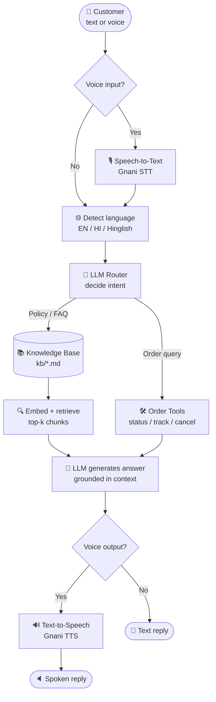

<div align="center">

# 🛒 ZentroMart VoiceOps

**A multilingual (English / Hindi / Hinglish) customer-support agent with RAG, order tools and voice.**


*Capstone for **From Tokens to Transformers: GenAI x LLM Mastery**, Consulting & Analytics Club, IIT Guwahati*

</div>

---

## ✨ What it does

ZentroMart is a fictional Indian online store. This agent answers customer questions the way a real support team would:

- 📚 **Answers from a knowledge base** (policies, shipping, returns) using Retrieval-Augmented Generation
- 📦 **Looks up orders** and performs actions through tool / function calling
- 🇮🇳 **Understands Hindi and Hinglish**, not just English
- 🎙️ **Speaks and listens** through speech-to-text and text-to-speech (Gnani)

## 🧠 Topics covered

| Topic | Where it is used |
|---|---|
| Tokenization & embeddings | Turning KB text and queries into vectors |
| Transformers / LLMs | Core reasoning and response generation |
| Prompt engineering | System prompt, tone, guardrails |
| RAG (Retrieval-Augmented Generation) | Answers grounded in `kb/*.md` |
| Tool / function calling | Order status, cancellation, tracking |
| Multilingual NLP | Hindi and Hinglish queries |
| Speech AI (STT / TTS) | Voice interface with Gnani |

## 🔄 How it works



## 📁 Project structure

```
.
├── kb/                 # Knowledge base (markdown documents)
├── data/               # Sample orders / datasets
├── app.py              # Main entry point
├── requirements.txt    # Dependencies
├── .env.example        # API key template
└── README.md
```

> Adjust the folder names above to match your actual repo.

## 🚀 Getting started

**1. Clone the repo**

```bash
git clone https://github.com/SHIVAMSINHA342/ZentroMart-VoiceOps-Capstone.git
cd ZentroMart-VoiceOps-Capstone
```

**2. Create a virtual environment and install dependencies**

```bash
python -m venv venv
source venv/bin/activate        # Windows: venv\Scripts\activate
pip install -r requirements.txt
```

**3. Add your API keys**

```bash
cp .env.example .env            # Windows: copy .env.example .env
# then edit .env and add your LLM and Gnani keys
```

**4. Run it**

```bash
python app.py
```

If you built a web UI with Streamlit, use `streamlit run app.py` instead.

## 🔗 Git setup (first push)

```bash
git init
git add .
git commit -m "Initial commit: ZentroMart AI support agent"
git branch -M main
git remote add origin https://github.com/SHIVAMSINHA342/ZentroMart-VoiceOps-Capstone.git
git push -u origin main
```

The repo lives at https://github.com/SHIVAMSINHA342/ZentroMart-VoiceOps-Capstone. Keep it **Public** so the capstone reviewers can open it. Never commit your `.env` file; add it to `.gitignore`.

## 💬 Example queries

| Language | Query |
|---|---|
| English | "Where is my order ZM1001?" |
| Hindi | "मेरा रिफंड कब मिलेगा?" |
| Hinglish | "Mera order cancel karna hai, kya ho sakta hai?" |

## 🛣️ Roadmap

- [x] Step 1: RAG over the knowledge base
- [x] Step 2: Order tools
- [x] Step 3: Hindi / Hinglish support
- [x] Step 4: Voice (STT + TTS)
- [ ] Evaluation set and answer-quality metrics
- [ ] Live demo deployment

## 👤 Author

**Shivam Kumar Sinha**
GitHub: [@SHIVAMSINHA342](https://github.com/SHIVAMSINHA342) · LinkedIn: [shivam-kumar-sinha](https://www.linkedin.com/in/shivam-kumar-sinha-99a05b2b9)

---

<div align="center">⭐ If you found this useful, give the repo a star!</div>
